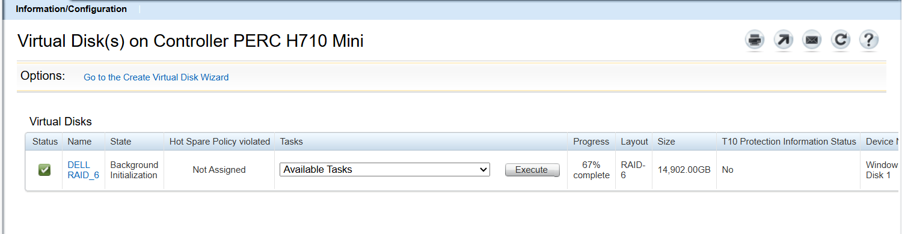

# Install Dell OpenManage Server Administrator (OMSA) on Windows 10

Dell OpenManage Server Administrator 9.5 can run as a local managed node on Windows 10. Chassis, fans, power, and a PERC all show up in the web UI. Dell's installer does not do this on its own. On a desktop Windows it installs the remote console and then asks for some other server's address.

This repository is the change that got past that, and the reason the disk and NIC filter drivers were left out. It was done on one machine: a PowerEdge R720, Windows 10 Pro 19045, OMSA 9.5.0 build 4063, PERC H710 Mini on Dell firmware 21.3.5-0002. After install, `omreport storage controller` reported that H710, and `omreport chassis info` reported the R720. The same four services were running: Server Administrator, DSM SA Event Manager (`dcevt64`), DSM SA Data Manager (`dcstor64`), and DSM SA Shared Services (`omsad`).



Background initialization was still running in that shot. Hot spare says Not Assigned because every disk is already in the RAID-6.

Dell did not support this OS for the 9.5 package. Later OMSA releases (10.2, 11.x) drop 12th-generation servers, so they are the wrong download for an R720. Nothing here replaces OMSA on a Windows Server install. On Server 2016 or 2019 the stock installer is the right one, and this patch is unnecessary.

The script does not contain Dell's installer. Download it from Dell.

## What the stock install does

`setup.exe` on Windows 10 stops at the prerequisite check. People hitting that usually see "no supported OS was found", get only the web server feature, and then a login page that wants a hostname or IP.

Installing `SysMgmtx64.msi` directly is not enough either. The MSI launch condition does let Windows 10 through (`OSCHECK="NO"` or `VersionNT>=600`, and a custom action sets `OSCHECK=NO`). A later custom action, `caOMILPreReqCheck`, logs "Enable only console on this system" and sets the feature status properties to 3. The Condition table turns each of those features to install level 0. `ADDLOCAL` does not override a feature whose level a condition just set to 0. A second install with a long `ADDLOCAL` list still left only `IWS` (the web server) on disk.

`IWS` is the piece that was staying. Everything else was being switched off: Server Instrumentation, storage management, CLI, WMI, SNMP, remote enablement, OS logging, the iDRAC command-line tools, and the NIC agent features.

## What to change

Work on a copy of the MSI. Leave the signed file from Dell alone. Windows Installer SecureRepair also rejects a modified MSI while the signed product is still installed, so uninstall a stock 9.5 first, then install the copy. The product code is `{4C7F1FB4-0A86-4309-B706-7F9659285F89}`.

`patch-omsa.ps1` does two things to the copy:

1. Deletes every Condition row with level 0. Those are the rows `CP_*STATUS=3` uses to turn features off. The level 101 rows (`CP_*STATUS=2`, feature not applicable) stay. On this machine the custom action set status 3, not 2, so those rows did not fire.
2. Sets component condition `0` on the kernel drivers that should not be on this OS. A condition of `0` means the component is not installed even if its feature is selected.

The features still requested at install time are:

`IWS, SI, MgmtInt, CLI, WMI, OSLOG, OMSS, NICInt, BRCM, INTEL, SNMP, RmtMgmt, iDRAC12G`

`INSTALLLEVEL=0` is there so a default level does not pull extra features in. Once the level-0 rows are gone, the MSI's own `INSTALLLEVEL` is 100 and every feature level is 1, so a plain install would take all of them.

All 13 features ended up installed (Windows Installer state 3). No reboot was required here. `msiexec` returned 0. If it returns 3010, Windows is asking for a reboot that this machine did not need.

If `omsad` is installed but disabled, set it to Automatic and start it. That happened on the first full install.

## Why those drivers stay out

OMSA does not need them to read a PERC or the chassis.

The storage feature ships software-RAID filter drivers: `bccfg*.sys` (several Windows Server builds), the Marvell `mv91cons` driver, and `afamgt.sys` plus `addfilter.exe`. They register on the disk class. Every read and write would go through a filter Dell built for Windows Server, including the boot disk. Uninstall does not always remove those UpperFilters or LowerFilters entries afterwards. A bad one is a bad day on a machine that is not a supported OS.

The Broadcom SNMP pieces ship `BASFND.sys` and `FADA64.sys`. Same kind of problem, on the network stack instead of the disk stack. The NIC agent features can still be selected. The kernel files are what the patch drops.

Two libraries stay exactly as Dell shipped them:

- `storelibit.dll`, which is how storage management talks to the PERC driver already on the machine (`percsas2i` on this H710).
- `BMAPIa.dll` component `BMAPIa.dll.945AC698_14D6_4E08_8866_F0E8DE5CE895`. That one belongs to Server Instrumentation and is user mode. A different `BMAPIa.dll` in the same MSI contains `FADA64.sys`. The script blocks that one and leaves this one alone. The component id is specific to the 9.5.0.4063 MSI, which is why the script refuses any other product version.

`dcdbas64.sys` is the driver that did install. OMSA uses it to read the chassis. It is not a disk filter. After this install the disk-class filters were still `partmgr`, `fltsrv` on top and `EhStorClass` underneath. `bccfg`, `mv91cons`, `afamgt`, `BASFND`, and `FADA64` were absent.

An IT-flashed H710 is not a PERC anymore. OMSA will say no controllers until the card is back on Dell RAID firmware. That is the card, not this patch.

## Run it

The package used here:

- File: `OM-SrvAdmin-Dell-Web-WINX64-9.5.0-4063_A00.exe`
- Size: 303065080 bytes
- SHA-256: `6847BA035EFC2DC75236881BE17241951A12899A985033A9E81BF4793D594AC9`
- Dell driver id 0DC12: <https://www.dell.com/support/home/en-us/drivers/driversdetails?driverid=0DC12>
- Direct file: <https://dl.dell.com/FOLDER06454068M/1/OM-SrvAdmin-Dell-Web-WINX64-9.5.0-4063_A00.exe>

The exe is a zip with a self-extractor header. .NET can unpack it. The MSI inside is `windows\SystemsManagementx64\SysMgmtx64.msi` (244828160 bytes).

```powershell
Add-Type -AssemblyName System.IO.Compression.FileSystem
[IO.Compression.ZipFile]::ExtractToDirectory(
  'C:\path\OM-SrvAdmin-Dell-Web-WINX64-9.5.0-4063_A00.exe',
  'C:\OpenManage')
```

Patch a copy. This does not install:

```powershell
powershell.exe -NoProfile -ExecutionPolicy Bypass -File .\patch-omsa.ps1 `
  -SourceMsi 'C:\OpenManage\windows\SystemsManagementx64\SysMgmtx64.msi' `
  -DestMsi 'C:\temp\omsa-win10\SysMgmtx64.msi'
```

If a stock copy is already installed, uninstall it from an elevated prompt first:

```text
msiexec.exe /x {4C7F1FB4-0A86-4309-B706-7F9659285F89} /qn REBOOT=ReallySuppress
```

Then run the `msiexec /i` line the script prints. It is the same command that returned 0 here:

```text
msiexec.exe /i C:\temp\omsa-win10\SysMgmtx64.msi ADDLOCAL=IWS,SI,MgmtInt,CLI,WMI,OSLOG,OMSS,NICInt,BRCM,INTEL,SNMP,RmtMgmt,iDRAC12G INSTALLLEVEL=0 REBOOT=ReallySuppress /qn /l*v %TEMP%\omsa-win10-install.log
```

Open `https://localhost:1311`. The certificate warning is the local Tomcat certificate. Sign in as the local Windows account on Web Server Login. The page that asks for a hostname is the remote console, which is the stock Windows 10 result, not this one.

The connection service listens on port 1311 on every interface, not only localhost. This install did not add a firewall allow rule. Do not add one unless you mean to expose it.

iDRAC Service Module is a separate product. It was already installed here and was left running. This OMSA install adds `racadm` under `C:\Program Files\Dell\SysMgt\OM_iDRACTools`. `racadm` can fail with "Resource currently in use by another process" while OMSA is talking to the iDRAC. That is the shared channel, not a failed install.

## What this is not

One R720. Not a test matrix. The login page was not modified for this write-up. A normal Windows password works on the stock form. Unused hardware is not grayed out. OMSA shows an empty page, or says the device is not there.

The script and this text are free to use and change. Dell's installer is not. Download it from Dell. Do not commit the MSI, the patched copy, or the unpacked tree.
